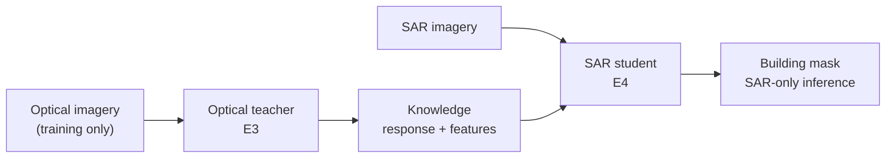
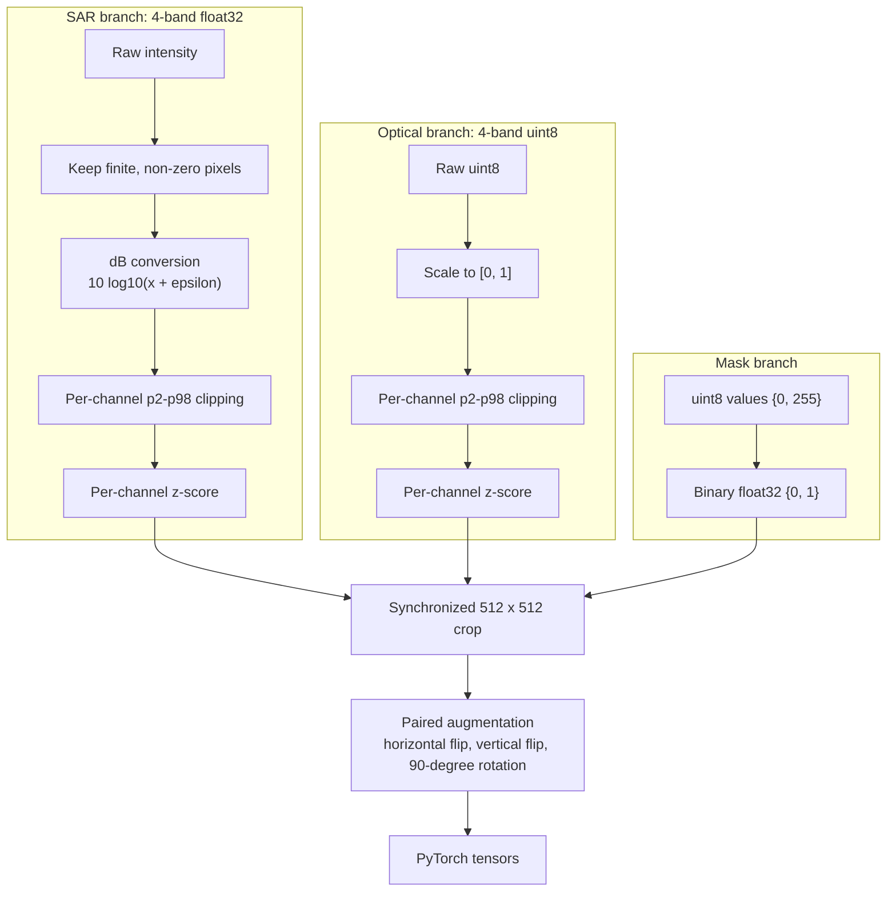
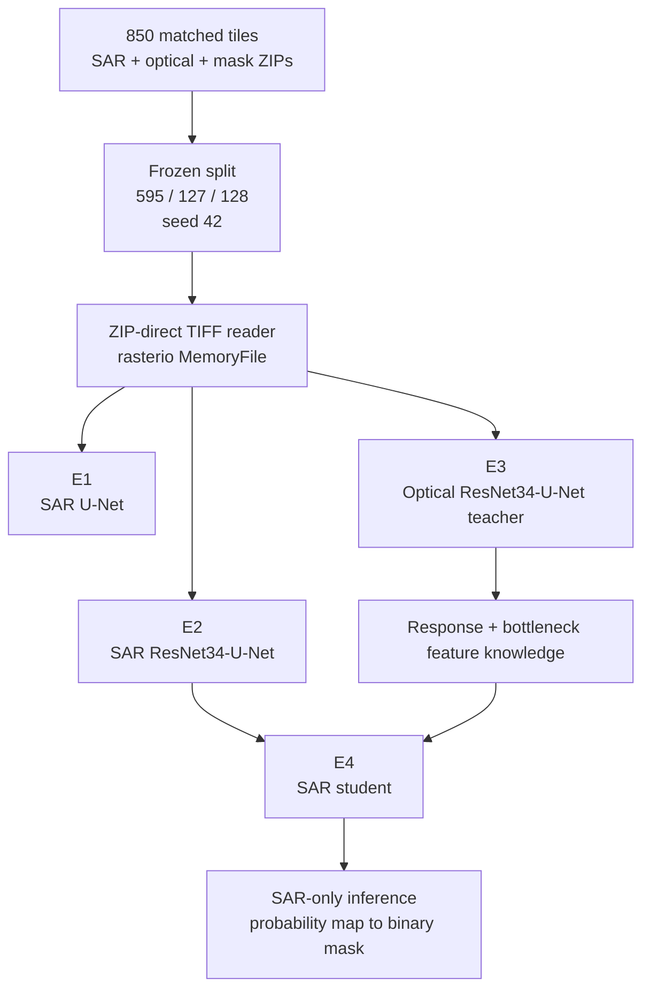
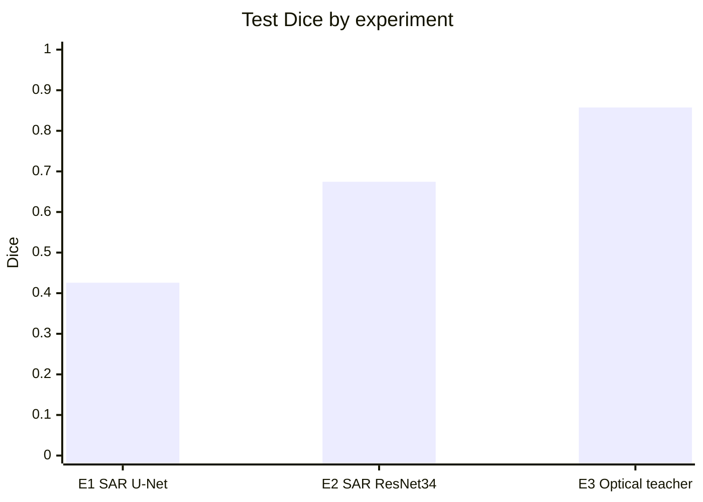
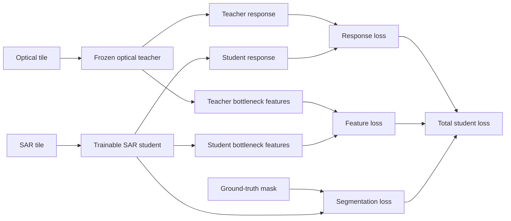

 # SpaceNet 6: SAR Building Footprint Extraction

## Optical-Assisted Training with SAR-Only Inference

**Status:** Active development. E1-E3 complete; E4 knowledge distillation is next.  
**Dataset:** SpaceNet 6, AOI 11 Rotterdam, working subset of 850 matched tiles.  
**Core principle:** Optical teaches. SAR operates.

## 1. Overview

This project builds a deep-learning system for extracting building footprints from Synthetic Aperture Radar (SAR) imagery. Optical imagery is used only during training as a privileged teacher modality and is never required during inference.

The research question is:

> Can knowledge distilled from optical imagery during training improve a model that must segment buildings from SAR alone?

The model produces a pixel-level building probability map, which is thresholded into a binary building mask. Georeferenced polygon outputs such as GeoJSON are planned as a derived GIS product.



## 2. Dataset

SpaceNet 6 is a multi-sensor, all-weather mapping dataset covering Rotterdam AOI 11. TIFF members remain inside ZIP archives and are read directly into memory; the project does not bulk-extract the archives.

| Property | SAR | Optical | Mask |
|---|---|---|---|
| Archive | `SN6_25_SAR.zip` (~10.3 GB) | `SN6_25_Optical.zip` (~2.6 GB) | `SN6_25_Masks.zip` (~0.6 GB) |
| Tile count | 850 | 850 | 850, all matched |
| Dimensions | 4 x 900 x 900 | 4 x 900 x 900 | 1 x 900 x 900 |
| Data type | `float32` | `uint8` | `uint8`, values `{0, 255}` |
| CRS / resolution | EPSG:32631 / 0.5 m | EPSG:32631 / 0.5 m | EPSG:32631 / 0.5 m |
| NoData | `0.0`, approximately 33.9% | None | `0.0` |

Training uses random 512 x 512 crops. Validation and test use deterministic center crops.

### Frozen split

The split uses seed 42 and is never redrawn.

| Split | Tiles | Share | File |
|---|---:|---:|---|
| Train | 595 | 70% | [`data/metadata/train.csv`](data/metadata/train.csv) |
| Validation | 127 | 15% | [`data/metadata/val.csv`](data/metadata/val.csv) |
| Test | 128 | 15% | [`data/metadata/test.csv`](data/metadata/test.csv) |
| Total | 850 | 100% | [`data/metadata/tile_manifest.csv`](data/metadata/tile_manifest.csv) |

Normalization statistics are computed from the training split only. No validation or test data is used for preprocessing statistics.

## 3. Preprocessing Pipeline



Verified training statistics are stored in [`data/metadata/verified_preprocessing_stats.json`](data/metadata/verified_preprocessing_stats.json). These notebook-verified values are authoritative; the locked architecture document contains an earlier legacy configuration.

| Band | SAR mean | SAR std | SAR p2 | SAR p98 | Optical mean | Optical std | Optical p98 |
|---:|---:|---:|---:|---:|---:|---:|---:|
| 1 | 14.417 | 1.246 | 11.355 | 16.481 | 0.2407 | 0.2220 | 0.7686 |
| 2 | 15.578 | 0.808 | 13.614 | 16.976 | 0.2500 | 0.2351 | 0.7961 |
| 3 | 15.272 | 0.910 | 13.018 | 16.809 | 0.2500 | 0.2351 | 0.7961 |
| 4 | 14.010 | 1.489 | 10.395 | 16.331 | 0.2647 | 0.2304 | 0.7686 |

SAR NoData pixels are excluded from statistics and pinned to zero after normalization.

## 4. Experiment Matrix

| Experiment | Input | Architecture | Knowledge distillation | Status | Purpose |
|---|---|---|---|---|---|
| E1 | SAR | U-Net, from scratch | None | Complete | Basic SAR baseline |
| E2 | SAR | ResNet34-U-Net, ImageNet initialization | None | Complete | Primary SAR model |
| E3 | Optical | ResNet34-U-Net, ImageNet initialization | None | Complete | Frozen optical teacher |
| E4a | SAR | ResNet34-U-Net | Response KD | Planned | Test output knowledge |
| E4b | SAR | ResNet34-U-Net | Feature KD | Planned | Test semantic feature knowledge |
| E4c | SAR | ResNet34-U-Net | Response + feature KD | Planned | Final proposed model |



## 5. Training Configuration

| Setting | Value |
|---|---|
| Optimizer | AdamW |
| Learning rate | `1e-4` |
| Weight decay | `1e-4` |
| Scheduler | Cosine annealing, `T_max = 60` |
| Batch size | 4 |
| Maximum epochs | 60 |
| Early stopping | Patience 10 |
| Gradient clipping | 1.0 |
| Mixed precision | AMP with float16 on CUDA |
| Segmentation loss | BCE + Dice, weights 1 / 1 |
| Random seed | 42 |

## 6. Results

### Validation results

Dice is the model-selection metric.

| Model | Best epoch | Validation Dice | Validation IoU |
|---|---:|---:|---:|
| E1 - SAR U-Net | 32 | 0.4340 | 0.2829 |
| E2 - SAR ResNet34-U-Net | 60 | 0.6666 | 0.5064 |
| E3 - Optical teacher | 59 | 0.8440 | 0.7320 |

### Test results

The test set remains untouched during training and model selection.

| Model | Parameters | Test Dice | Test IoU | Precision | Recall |
|---|---:|---:|---:|---:|---:|
| E1 - SAR U-Net | 31.0 M | 0.4258 | 0.2806 | 0.4411 | 0.4513 |
| E2 - SAR ResNet34-U-Net | 24.4 M | 0.6745 | 0.5235 | 0.7046 | 0.6661 |
| E3 - Optical teacher | 24.4 M | 0.8574 | 0.7548 | 0.8793 | 0.8403 |



### Findings

- The pretrained ResNet34-U-Net improves test Dice by 0.2487 over the from-scratch U-Net baseline while using fewer parameters.
- The optical teacher exceeds the best SAR model by 0.1829 test Dice, establishing a meaningful modality gap and the motivation for E4.
- Validation and training behavior for E2 and E3 show no severe overfitting in the recorded experiments.

These are pixel-level Dice and IoU metrics. Canonical SpaceNet instance-level F1 at IoU 0.5 requires the original building-footprint polygons and is deferred to the evaluation phase.

## 7. Repository Structure

```text
SN6_Multi-Sensor All-Weather Mapping/
├── data/
│   ├── raw/
│   │   ├── SN6_25_SAR.zip
│   │   ├── SN6_25_Optical.zip
│   │   └── SN6_25_Masks.zip
│   └── metadata/
│       ├── tile_manifest.csv
│       ├── train.csv
│       ├── val.csv
│       ├── test.csv
│       └── verified_preprocessing_stats.json
├── configs/
│   └── preprocessing_config.json
├── outputs/
│   ├── checkpoints/
│   │   ├── E1_SAR_UNet_best.pth
│   │   └── E2_ResNet34_UNet_best.pth
│   ├── figures/
│   ├── logs/
│   ├── metrics/
│   └── predictions/
├── main.ipynb
├── testing_zip_data.ipynb
└── README.md
```

## 8. Usage

The main pipeline is implemented in [`main.ipynb`](main.ipynb). Set `PROJECT_ROOT` to the local project path and run the notebook from top to bottom.

```python
PROJECT_ROOT = Path(r"C:\College\Projects\SN6_Multi-Sensor All-Weather Mapping")
```

The notebook stages are:

1. Validate ZIP files and build the master manifest.
2. Restore and validate the frozen split.
3. Read TIFF members directly from ZIP archives and calculate statistics.
4. Build datasets and dataloaders.
5. Train and evaluate E1 and E2. E3 is the optical-teacher stage in the planned research workflow.

SAR-only inference produces a probability map and binary mask:

```python
model.load_state_dict(
    torch.load("outputs/checkpoints/E4_*.pth", map_location=DEVICE)["model_state_dict"]
)

with torch.no_grad():
    logits = model(sar_tensor)
    probability = torch.sigmoid(logits)
    mask = (probability >= threshold).float()
```

### Requirements

- Python 3.10
- PyTorch and torchvision
- rasterio
- NumPy
- pandas
- Optional: albumentations, Shapely, OpenCV, SciPy, scikit-learn, Matplotlib

## 9. Knowledge Distillation Design

The planned E4 student combines segmentation supervision with response and bottleneck feature distillation:

$$
L_{total} = L_{seg} + \lambda_{resp}L_{resp} + \lambda_{feat}L_{feat},
\qquad \lambda_{resp}=0.5,\quad \lambda_{feat}=0.1,\quad T=4
$$

- **Response KD:** KL divergence between temperature-softened teacher and student outputs.
- **Feature KD:** cosine-distance alignment between bottleneck features.
- **Frozen teacher:** only the SAR student is updated.
- **Warm-up:** distillation weights are increased during the early training epochs.



## 10. Roadmap

| Phase | Content | Status |
|---|---|---|
| 1 - Core | ZIP loader, frozen manifest and split, preprocessing, E1-E3 | Complete |
| 2 - Distillation | E4a response KD, E4b feature KD, E4c combined | Next |
| 3 - Evaluation | Validation threshold tuning, SpaceNet F1 with polygon labels, building-size error analysis | Planned |
| 4 - Ablations | Lee/refined-Lee filtering, EfficientNet-U-Net, DeepLabV3+ | Optional |
| 5 - Instance-aware modeling | Border-aware targets and distance-transform supervision | Future; requires instance labels |
| 6 - Deployment | SAR GeoTIFF to footprints to GeoJSON/GIS | Future |

## 11. Development Governance

1. The split is frozen at seed 42 with 595/127/128 tiles for train/validation/test.
2. Test data must not influence normalization, threshold selection, or hyperparameter decisions.
3. The final model must perform inference from SAR alone.
4. E1 remains the baseline for meaningful comparison.
5. Each experiment should record its configuration, seed, metrics, and checkpoint.
6. Pixel metrics such as Dice and IoU must not be presented as SpaceNet instance F1.
7. New models, losses, filters, and preprocessing changes must be introduced as controlled experiments.

## References

1. Shermeyer, J. et al. (2020). *SpaceNet 6: Multi-Sensor All Weather Mapping Dataset*. CVPR Workshops.
2. Ronneberger, O. et al. (2015). *U-Net: Convolutional Networks for Biomedical Image Segmentation*. MICCAI.
3. He, K. et al. (2016). *Deep Residual Learning for Image Recognition*. CVPR.
4. Hinton, G. et al. (2015). *Distilling the Knowledge in a Neural Network*.
5. Liu, Y. et al. (2019). *Structured Knowledge Distillation for Semantic Segmentation*. CVPR.