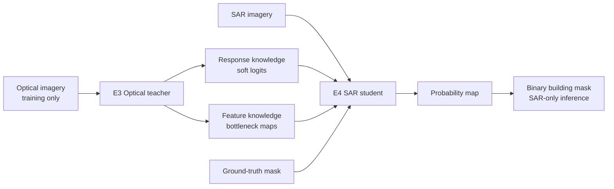
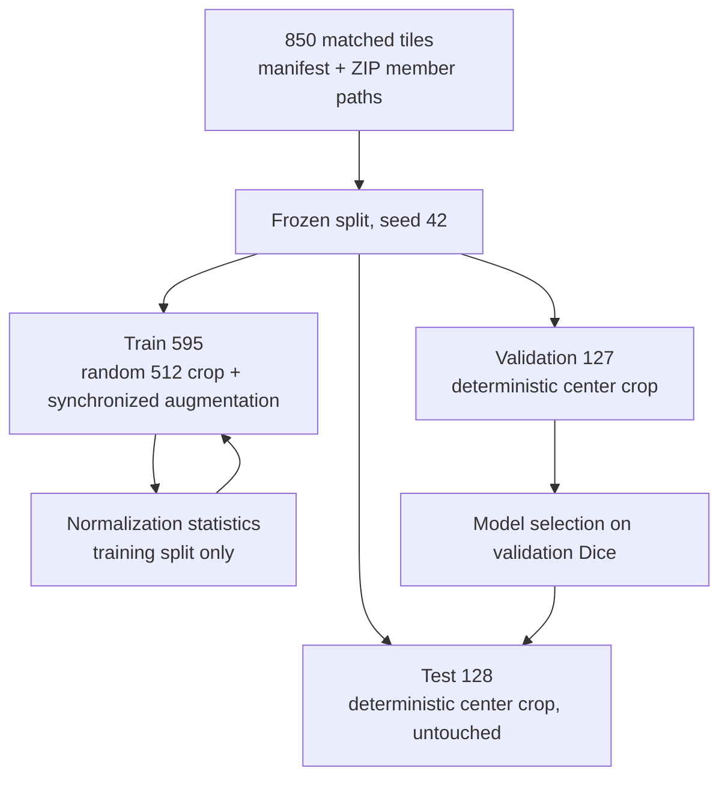
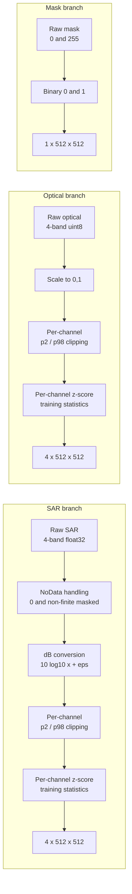
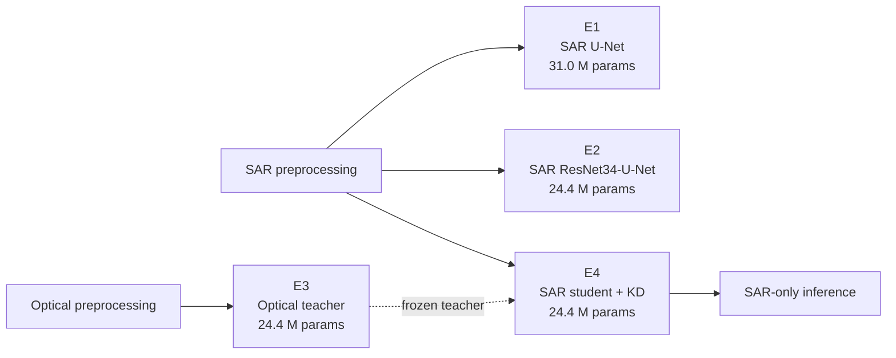
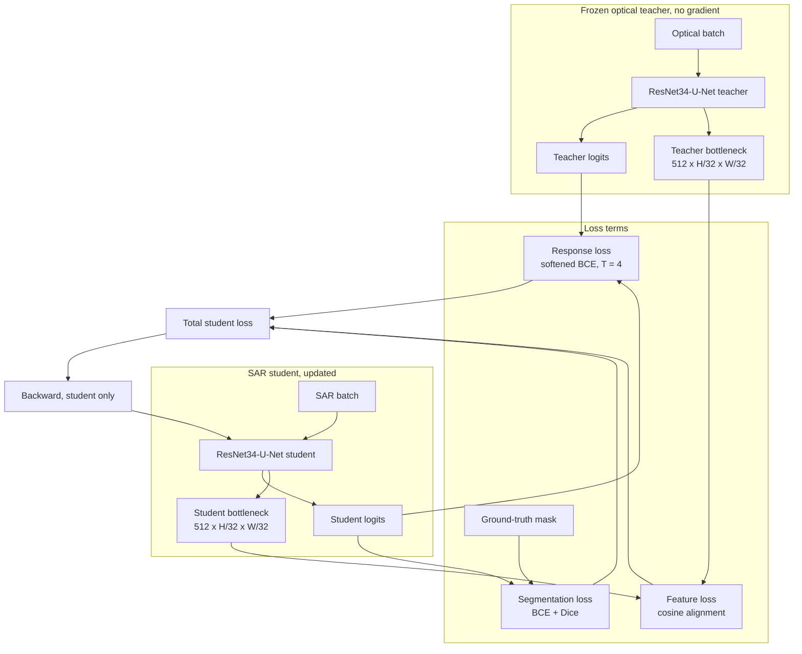
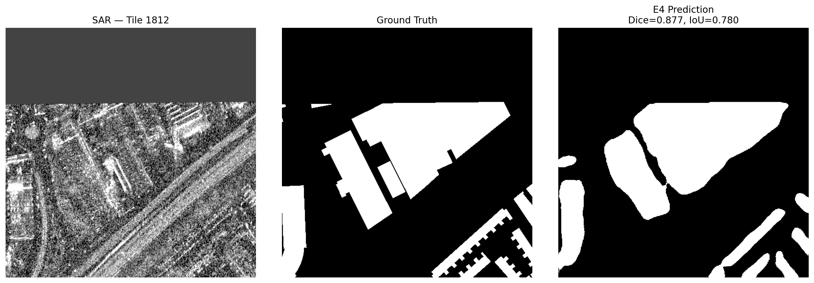
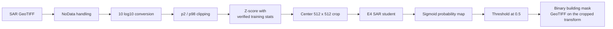
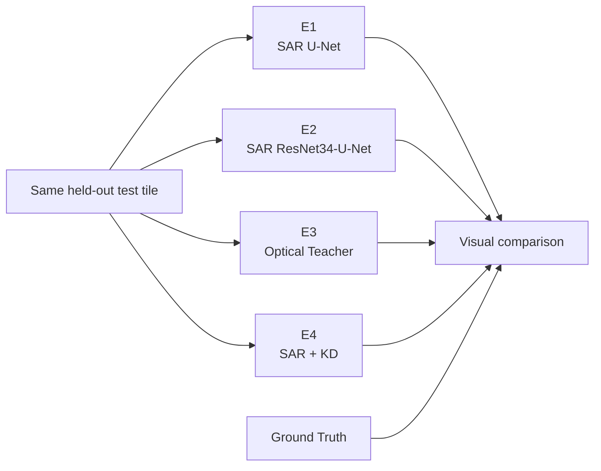
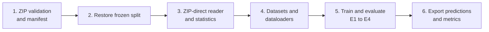
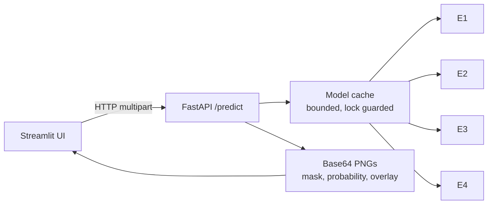

# SpaceNet 6 — SAR Building Footprint Extraction

## Optical-Assisted Training with SAR-Only Inference

<div align="center">

**Research Project · Deep Learning · Remote Sensing · Semantic Segmentation**

### **Amulya Gavankar**

**SpaceNet 6 · AOI 11 Rotterdam**

> **Optical teaches. SAR operates.**

</div>

---

## Table of Contents

1. [Overview](#1-overview)
2. [Dataset](#2-dataset)
3. [Preprocessing pipeline](#3-preprocessing-pipeline)
4. [Experiment matrix](#4-experiment-matrix)
5. [Knowledge distillation design](#5-knowledge-distillation-design)
6. [Results](#6-results)
7. [Prediction example](#7-prediction-example)
8. [Repository structure](#8-repository-structure)
9. [Usage](#9-usage)
10. [Serving the models](#10-serving-the-models)
11. [Roadmap](#11-roadmap)
12. [Development governance](#12-development-governance)
13. [References](#references)

---

# 1. Research Overview

This project trains deep-learning models to extract building footprints from Synthetic Aperture Radar (SAR) imagery while using optical imagery only as a teacher during training. The final system infers buildings from SAR alone, which is the defining requirement for all-weather mapping.

The research question is:

> Can knowledge transferred from optical imagery during training improve a model that must segment buildings from SAR alone?

The pipeline reads TIFF tiles directly from ZIP archives, builds a frozen train/validation/test split, preprocesses SAR and optical inputs, and trains segmentation models with a U-Net-style ResNet34 backbone.



The optical teacher is a training-time component only. It is absent from the inference path.

---

# 2. Dataset

SpaceNet 6 is a multi-sensor, all-weather mapping dataset covering Rotterdam AOI 11. TIFF members remain inside ZIP archives and are read directly into memory; the project does not bulk-extract the archives.

| Property | SAR | Optical | Mask |
|---|---|---|---|
| Archive | `SN6_25_SAR.zip` (~10.3 GB) | `SN6_25_Optical.zip` (~2.6 GB) | `SN6_25_Masks.zip` (~0.6 GB) |
| Tile count | 850 | 850 | 850, all matched |
| Dimensions | 4 x 900 x 900 | 4 x 900 x 900 | 1 x 900 x 900 |
| Data type | `float32` | `uint8` | `uint8`, values `{0, 255}` |
| CRS / resolution | EPSG:32631 / 0.5 m | EPSG:32631 / 0.5 m | EPSG:32631 / 0.5 m |
| NoData | `0.0`, approximately 33.9% | None | `0.0` |

Training uses random 512 x 512 crops. Validation and test use deterministic center crops.

### Frozen split

The split uses seed 42 and is never redrawn.

| Split | Tiles | Share | File |
|---|---:|---:|---|
| Train | 595 | 70% | [`data/metadata/train.csv`](data/metadata/train.csv) |
| Validation | 127 | 15% | [`data/metadata/val.csv`](data/metadata/val.csv) |
| Test | 128 | 15% | [`data/metadata/test.csv`](data/metadata/test.csv) |
| Total | 850 | 100% | [`data/metadata/tile_manifest.csv`](data/metadata/tile_manifest.csv) |



Normalization statistics are computed from the training split only. No validation or test data influences preprocessing statistics.

---

# 3. Preprocessing

SAR is not processed like RGB imagery. Optical inputs are scaled to `[0,1]`, clipped, and z-scored. Targets are converted from `{0,255}` to binary `{0,1}`.



Verified preprocessing statistics are stored in [`data/metadata/verified_preprocessing_stats.json`](data/metadata/verified_preprocessing_stats.json). These notebook-verified values are authoritative and are what the API loads at inference time.

| Band | SAR mean | SAR std | SAR p2 | SAR p98 | Optical mean | Optical std | Optical p98 |
|---:|---:|---:|---:|---:|---:|---:|---:|
| 1 | 14.417 | 1.246 | 11.355 | 16.481 | 0.2407 | 0.2220 | 0.7686 |
| 2 | 15.578 | 0.808 | 13.614 | 16.976 | 0.2500 | 0.2351 | 0.7961 |
| 3 | 15.272 | 0.910 | 13.018 | 16.809 | 0.2500 | 0.2351 | 0.7961 |
| 4 | 14.010 | 1.489 | 10.395 | 16.331 | 0.2647 | 0.2304 | 0.7686 |

> **Note on older statistics.** [`configs/preprocessing_config.json`](configs/preprocessing_config.json) still holds an earlier draft set of SAR statistics that treated no-data pixels as `-60 dB` (mean near `-10.79`, std near `35.2`). Those values are not the values the trained checkpoints were fit on. The verified JSON file takes precedence; the API only falls back to the config if the verified file is missing.

---

# 4. Experimental Design

| Experiment | Input | Architecture | Knowledge distillation | Status | Purpose |
|---|---|---|---|---|---|
| E1 | SAR | U-Net, from scratch | None | Complete | Basic SAR baseline |
| E2 | SAR | ResNet34-U-Net, ImageNet initialization | None | Complete | Primary SAR model |
| E3 | Optical | ResNet34-U-Net, ImageNet initialization | None | Complete | Optical teacher |
| E4 | SAR | ResNet34-U-Net, KD student | Response + feature distillation | Complete | SAR student with optical teacher guidance |



The E4 student is trained with a frozen optical teacher and a SAR-only inference objective.

---

# 5. Knowledge Distillation

The E4 student combines segmentation supervision with response and bottleneck-feature distillation. This follows the structured knowledge distillation formulation for semantic segmentation (Liu et al., 2019): early optical features encode colour and texture that has no direct counterpart in SAR backscatter, so feature transfer is restricted to the bottleneck representation.

### Training graph



The teacher is detached from the graph, so gradients flow to the student alone.

### Loss composition

$$
L_{total} = L_{seg} + \lambda_{resp} L_{resp} + \lambda_{feat} L_{feat}
$$

| Component | Definition | Value used |
|---|---|---|
| $L_{seg}$ | BCE + Dice against ground truth | 1.0 + 1.0 |
| $L_{resp}$ | Softened teacher/student output matching, temperature 4.0 | $\lambda_{resp} = 0.1$ |
| $L_{feat}$ | Bottleneck feature alignment, cosine form | $\lambda_{feat} = 0.1$ |
| Warmup | Distillation weights ramped over the first epochs | 6 epochs |

- **Response KD:** soft target matching between teacher and student logits, implemented in the binary sigmoid/logit formulation rather than a two-class softmax.
- **Feature KD:** bottleneck-feature alignment between optical teacher and SAR student, so semantic structure is transferred without forcing identical magnitudes.
- **Inference goal:** SAR-only inference after training. The teacher is never loaded at inference time.

> The locked architecture document lists $\lambda_{resp} = 0.5$ as the *initial* proposal. The completed E4 run used 0.1 for both terms, as recorded in [`outputs/metrics/E4_final_summary.json`](outputs/metrics/E4_final_summary.json).

---

## Research Results at a Glance

| Model | Input | Test Dice | Test IoU | Precision | Recall |
|---|---|---:|---:|---:|---:|
| **E1 — SAR U-Net** | SAR | 0.4258 | 0.2806 | 0.4411 | 0.4513 |
| **E2 — SAR ResNet34-U-Net** | SAR | 0.6745 | 0.5235 | 0.7046 | 0.6661 |
| **E3 — Optical Teacher** | Optical | 0.8574 | 0.7548 | 0.8793 | 0.8403 |
| **E4 — SAR + Optical KD** | SAR | **0.7070** | **0.5627** | **0.7342** | **0.6931** |

### E2 → E4 Change

| Metric | E2 | E4 | Change |
|---|---:|---:|---:|
| Dice | 0.6745 | 0.7070 | **+0.0325** |
| IoU | 0.5235 | 0.5627 | **+0.0392** |
| Precision | 0.7046 | 0.7342 | **+0.0296** |
| Recall | 0.6661 | 0.6931 | **+0.0270** |


---

# 6. Results

### Validation results

Dice is the model-selection metric.

| Model | Best epoch | Validation Dice | Validation IoU |
|---|---:|---:|---:|
| E1 - SAR U-Net | 32 | 0.4340 | 0.2829 |
| E2 - SAR ResNet34-U-Net | 60 | 0.6666 | 0.5064 |
| E3 - Optical teacher | 59 | 0.8440 | 0.7320 |
| E4 - SAR student + KD | 56 | 0.7027 | 0.5483 |

### Test results

The test set remains untouched during training and model selection.

| Model | Parameters | Test Dice | Test IoU | Precision | Recall |
|---|---:|---:|---:|---:|---:|
| E1 - SAR U-Net | 31.0 M | 0.4258 | 0.2806 | 0.4411 | 0.4513 |
| E2 - SAR ResNet34-U-Net | 24.4 M | 0.6745 | 0.5235 | 0.7046 | 0.6661 |
| E3 - Optical teacher | 24.4 M | 0.8574 | 0.7548 | 0.8793 | 0.8403 |
| E4 - SAR student + KD | 24.4 M | 0.7070 | 0.5627 | 0.7342 | 0.6931 |

Source: [`outputs/metrics/final_experiment_results.csv`](outputs/metrics/final_experiment_results.csv) and [`outputs/metrics/E4_final_summary.json`](outputs/metrics/E4_final_summary.json).



*E4 student prediction on test tile 1812. Panels left to right: SAR band 1, ground-truth mask, predicted building mask. Optical imagery is not used at inference.*

### Key findings

- E4 improves over E2 by **+0.0325 test Dice** and **+0.0392 test IoU**, confirming that optical teacher guidance provides a measurable boost to the SAR-only student.
- The improvement is consistent on both validation and test, so it is not a split artifact.
- The optical teacher remains substantially stronger than the SAR student, which supports the modality gap and the value of knowledge transfer.
- A residual gap to the teacher remains. Closing it is the motivation for the evaluation and ablation phases.

These are pixel-level Dice and IoU metrics. Canonical SpaceNet instance-level F1 at IoU 0.5 requires the original building-footprint polygons and is deferred to the evaluation phase.

---

# 7. Prediction Example

The final inference path contains only the SAR student:



Example inference pattern:

```python
model.load_state_dict(
    torch.load(
        "outputs/checkpoints/E4_SAR_KD_best.pth",
        map_location=DEVICE,
    )["model_state_dict"]
)

with torch.no_grad():
    logits = model(sar_tensor)
    probabilities = torch.sigmoid(logits)
    mask = (probabilities >= 0.5).float()
```

Per-tile predictions and metrics for all test tiles are written to [`outputs/predictions/E4_test_predictions.csv`](outputs/predictions/E4_test_predictions.csv).

---

### Same-Tile Model Comparison

The final presentation view compares E1, E2, E3, and E4 on the same held-out tile so that predicted building footprints can be inspected visually alongside the numerical metrics.

| Ground Truth | E1 | E2 | E3 | E4 |
|---|---|---|---|---|
| Reference mask | SAR U-Net | SAR ResNet34-U-Net | Optical Teacher | SAR + KD Student |



# 8. Repository Structure

```text
SN6_Multi-Sensor All-Weather Mapping/
├── api/
│   ├── main.py             # FastAPI app, upload limits, API-key auth
│   ├── inference.py        # Bounded model cache, prediction, metrics
│   ├── models.py           # E1/E2/E3/E4 definitions and checkpoint loading
│   └── preprocessing.py    # SAR and optical preprocessing from verified stats
├── app/
│   └── streamlit_app.py    # Streamlit UI, calls the API on 127.0.0.1:8000
├── data/
│   ├── raw/
│   │   ├── SN6_25_SAR.zip
│   │   ├── SN6_25_Optical.zip
│   │   └── SN6_25_Masks.zip
│   └── metadata/
│       ├── tile_manifest.csv
│       ├── train.csv
│       ├── val.csv
│       ├── test.csv
│       └── verified_preprocessing_stats.json
├── configs/
│   └── preprocessing_config.json
├── outputs/
│   ├── checkpoints/        # E1-E4 best weights, git-ignored
│   ├── figures/
│   ├── logs/
│   ├── metrics/
│   │   ├── final_experiment_results.csv
│   │   ├── E4_final_summary.json
│   │   └── E2_vs_E4_improvement.csv
│   └── predictions/
│       ├── E4_test_predictions.csv
│       └── E4_tile_*_comparison.png
├── main.ipynb              # full training and evaluation pipeline
├── testing_zip_data.ipynb  # ZIP reader validation
├── requirements.txt
├── README.md
├── SpaceNet6_SAR_Building_Extraction_Locked_Architecture.md
└── .gitignore
```

---

# 9. Usage

Install dependencies:

```bash
pip install -r requirements.txt
```

The main workflow is implemented in [`main.ipynb`](main.ipynb). Set `PROJECT_ROOT` to the local project root and run the notebook from top to bottom.

```python
PROJECT_ROOT = Path(r"C:\College\Projects\SN6_Multi-Sensor All-Weather Mapping")
```

The notebook stages are:

1. Validate ZIP files and build the master manifest.
2. Restore and validate the frozen split.
3. Read TIFF members directly from ZIP archives and calculate statistics.
4. Build datasets and dataloaders.
5. Train and evaluate E1–E4.
6. Load the best SAR student checkpoint for SAR-only inference.



---

# 10. Inference and Application

The API and the Streamlit UI expose the trained checkpoints for ad hoc inference on uploaded GeoTIFFs.



Start the API:

```bash
uvicorn api.main:app --host 127.0.0.1 --port 8000
```

Start the UI:

```bash
streamlit run app/streamlit_app.py
```

Configuration is through environment variables:

| Variable | Default | Purpose |
|---|---|---|
| `SN6_API_KEY` | unset | When set, `/predict` requires a matching `X-API-Key` header. Unset means local, unauthenticated use. |
| `SN6_MAX_UPLOAD_MB` | `64` | Per-file upload size limit. Larger uploads are rejected with HTTP 413. |
| `SN6_MODEL_CACHE_SIZE` | `1` | Number of checkpoints kept resident. The least recently used model is evicted beyond this. |

Endpoints:

| Method | Path | Purpose |
|---|---|---|
| `GET` | `/` | Service metadata |
| `GET` | `/health` | Liveness, auth state, upload limit |
| `GET` | `/models` | Available models and modalities |
| `POST` | `/predict` | Run a model on an uploaded GeoTIFF, optional ground truth for metrics |
| `POST` | `/models/{name}/unload` | Release cached checkpoints |

> The API runs a deterministic center 512 x 512 crop. Ground truth must be supplied pre-cropped to the same region, otherwise the shape check rejects the request.

---

# 11. Roadmap

| Phase | Content | Status |
|---|---|---|
| 1 - Core | ZIP loader, frozen manifest and split, preprocessing, E1-E3 | Complete |
| 2 - Distillation | E4 KD student with response and feature distillation | Complete |
| 3 - Evaluation | Validation threshold tuning, SpaceNet F1 with polygon labels, building-size error analysis | Planned |
| 4 - Ablations | Lee/refined-Lee filtering, EfficientNet-U-Net, DeepLabV3+ | Optional |
| 5 - Instance-aware modeling | Border-aware targets and distance-transform supervision | Future; requires instance labels |
| 6 - Deployment | SAR GeoTIFF to footprints to GeoJSON/GIS | Future |

---

# 12. Research Governance

1. The split is frozen at seed 42 with 595/127/128 tiles for train/validation/test.
2. Test data must not influence normalization, threshold selection, or hyperparameter decisions.
3. The final model must perform inference from SAR alone.
4. E1 remains the baseline for meaningful comparison.
5. Each experiment should record its configuration, seed, metrics, and checkpoint.
6. Pixel metrics such as Dice and IoU must not be presented as SpaceNet instance F1.
7. New models, losses, filters, and preprocessing changes must be introduced as controlled experiments.
8. The locked architecture document is normative. This README summarizes; it does not override it.

---

# 13. References

1. Shermeyer, J. et al. (2020). *SpaceNet 6: Multi-Sensor All Weather Mapping Dataset*. CVPR Workshops.
2. Ronneberger, O. et al. (2015). *U-Net: Convolutional Networks for Biomedical Image Segmentation*. MICCAI.
3. He, K. et al. (2016). *Deep Residual Learning for Image Recognition*. CVPR.
4. Hinton, G. et al. (2015). *Distilling the Knowledge in a Neural Network*.
5. Liu, Y. et al. (2019). *Structured Knowledge Distillation for Semantic Segmentation*. CVPR.
---

<div align="center">

### SpaceNet 6 · AOI 11 Rotterdam

**SAR Building Footprint Extraction**

### **Amulya Gavankar**

> **Optical teaches. SAR operates.**

</div>
