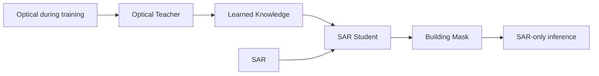
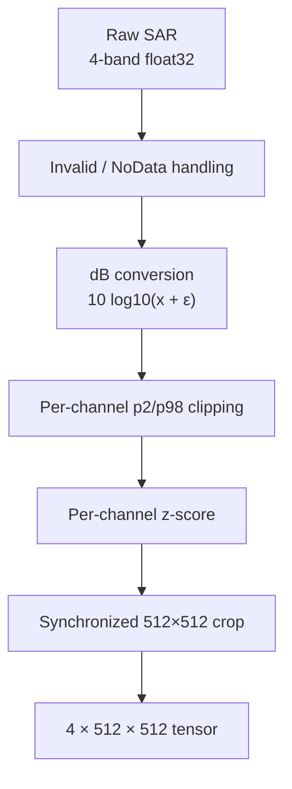
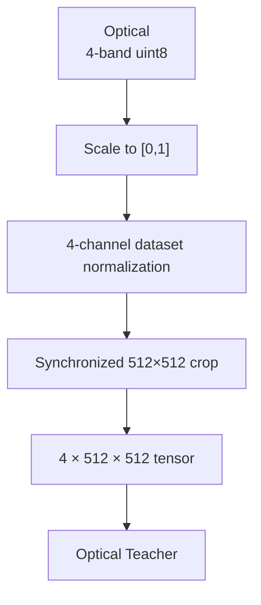
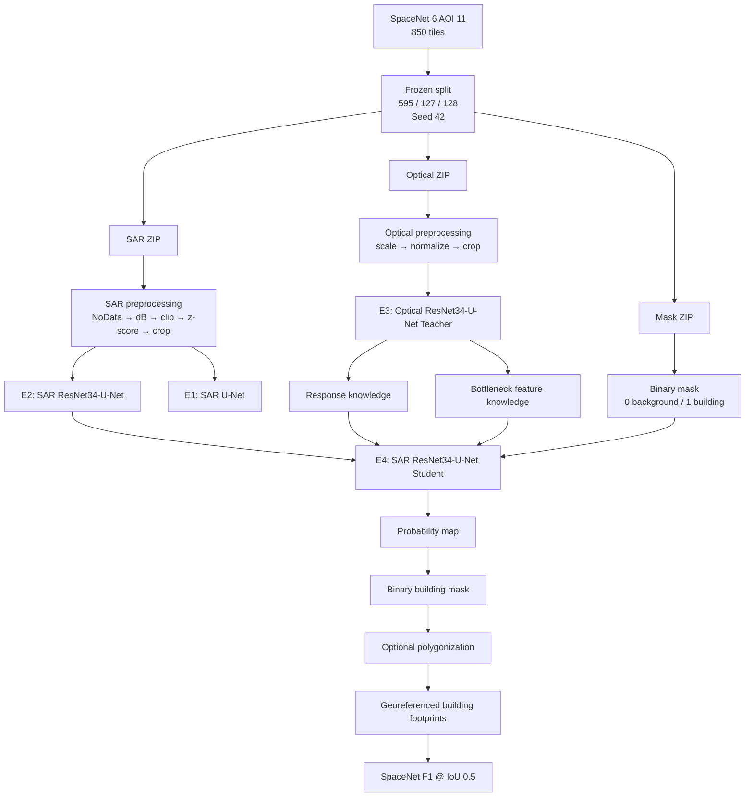
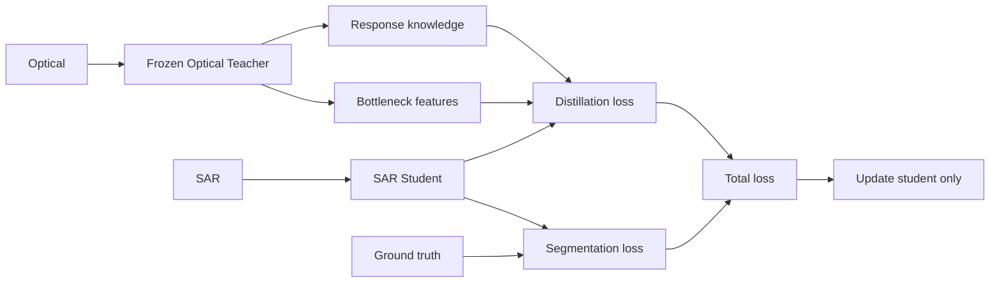
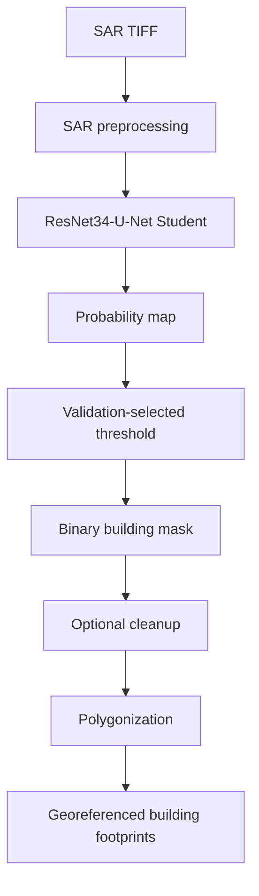
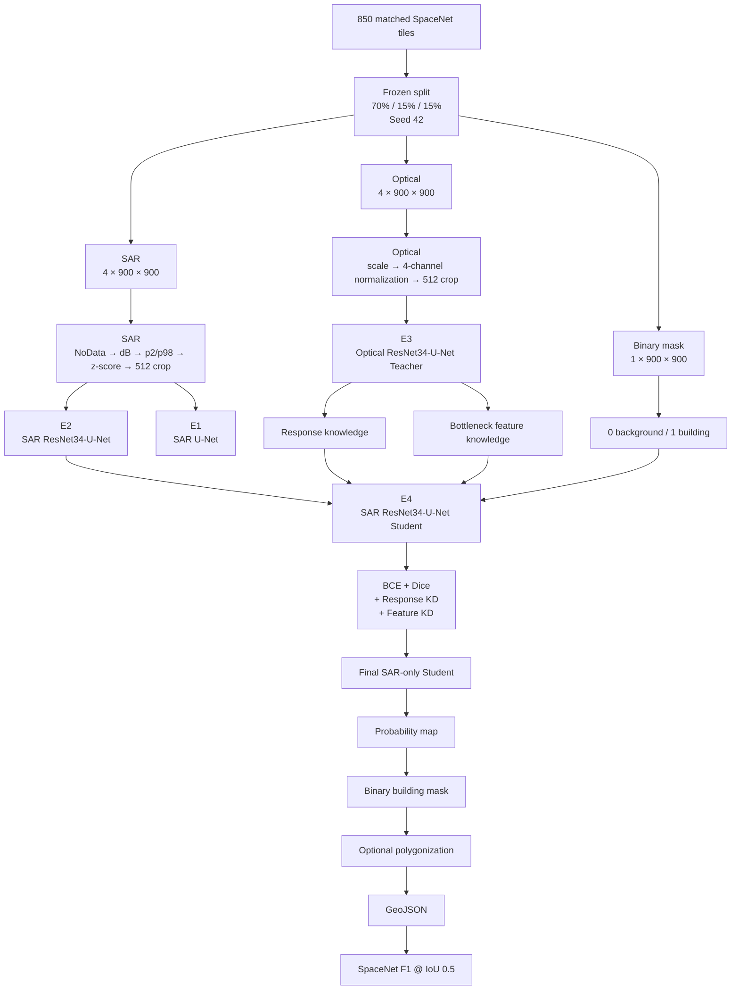

# SpaceNet 6 AOI 11 Rotterdam — SAR Building Footprint Extraction
## Locked Architecture & Development Reference

**Document status:** Locked Architecture Baseline  
**Version:** 1.0  
**Primary dataset:** SpaceNet 6 — AOI 11 Rotterdam subset  
**Working subset:** 850 matched SAR + Optical + Mask tiles  
**Primary inference modality:** SAR only  
**Research direction:** Optical-assisted training with SAR-only inference

---

# 1. Introduction

## 1.1 What we are building

This project builds a deep-learning system that extracts **building footprints from Synthetic Aperture Radar (SAR) imagery**.

The defining requirement is that the final model must operate using **SAR alone**. Optical imagery is available during training as an additional source of information, but it is not a deployment requirement.

The project therefore investigates:

> **Can knowledge learned from optical imagery during training improve a model that must perform building extraction from SAR alone?**

The neural network produces a pixel-level building probability map and binary building mask. When authoritative building-footprint polygons are available, the raster output can additionally be converted into georeferenced polygons for instance-level SpaceNet evaluation.

## 1.2 Vision

The long-term vision is an **all-weather building mapping system** that remains useful when optical imagery is unavailable because of cloud cover, darkness, or acquisition constraints.

The project is therefore not simply a generic image-segmentation exercise. It studies how information from a clearer optical modality can improve a model that ultimately operates on SAR.

### High-level concept



### Section summary

The project is a **SAR building-footprint segmentation system** whose main research idea is **optical-assisted learning followed by SAR-only inference**.

---

# 2. Purpose

## 2.1 Problem

Building mapping is useful for urban mapping, infrastructure inventories, disaster response, GIS, and related geospatial applications.

Optical imagery can provide visually intuitive building information, but optical acquisition can be affected by cloud cover and illumination. SAR provides an alternative sensing modality and is central to the all-weather motivation of SpaceNet 6.

SpaceNet 6 was designed around multi-sensor, all-weather mapping and included SAR building-footprint extraction as a core challenge.

## 2.2 Research question

The project is centered on:

> **Can optical imagery provide useful knowledge during training that improves SAR-only building extraction?**

This creates two clearly separated phases.

### Training

```text
Optical ──► Teacher
               │
               ▼
          Knowledge
               │
SAR ─────► Student
```

### Inference

```text
SAR ─────► Student ─────► Building Mask
```

The optical teacher is therefore a **training-time component**, not a deployment dependency.

## 2.3 Why this approach

The experiments progressively answer:

1. How well can SAR alone perform?
2. Does a stronger CNN architecture improve SAR segmentation?
3. Can an optical model learn useful building representations?
4. Does transferring optical knowledge improve the SAR student?
5. Does response knowledge, high-level feature knowledge, or both provide useful improvement?

## 2.4 Scope

### Included

- SAR building segmentation
- Optical teacher training
- SAR student training
- Knowledge distillation
- Binary building masks
- Pixel-level segmentation metrics
- Optional building polygon generation
- SpaceNet-style instance evaluation when authoritative polygon labels are available

### Not part of the core system

- Optical + SAR fusion as the required inference model
- SegFormer or other hardware-heavy Transformer models
- Large-scale production deployment
- Real-time inference
- Automatic SAR speckle filtering as a required preprocessing step
- Border-aware three-class segmentation as the initial target

### Section summary

The purpose is to develop and evaluate a **SAR-only inference model whose training is enhanced by optical knowledge**, while keeping the system practical for the available hardware.

---

# 3. Development Process

## 3.1 Methodology

Development proceeds in controlled stages:


Every comparable experiment uses:

- The same frozen dataset split
- The same core preprocessing
- Controlled augmentation
- Recorded configurations
- Saved checkpoints
- Validation-based model selection
- A test set used only for final evaluation

## 3.2 Dataset

The working dataset contains:

```text
850 matched tiles
├── SAR
├── Optical
└── Mask
```

Actual inspected dimensions:

```text
SAR:     4 × 900 × 900, float32
Optical: 4 × 900 × 900, uint8
Mask:    1 × 900 × 900, float32
```

Training crop size:

```text
512 × 512
```

The data remains inside ZIP archives. Individual TIFF members are read directly from the archives into memory instead of bulk-extracting all files.

This keeps disk usage low while allowing normal dataset-level shuffling.

## 3.3 Frozen split

```text
850 tiles
│
├── Train:      595
├── Validation: 127
└── Test:       128
```

Random seed:

```text
42
```

The split is frozen and reused by every experiment.

A manifest maps each tile ID to:

```text
tile_id
sar_member
optical_member
mask_member
split
```

The manifest is the authoritative modality mapping.

## 3.4 SAR preprocessing

SAR is not processed like RGB imagery.



The current locked training statistics are:

```text
SAR mean:
[-10.7919, -10.0244, -10.2262, -11.0609]

SAR std:
[35.2331, 35.7726, 35.6315, 35.0507]

SAR p2:
[-60, -60, -60, -60]

SAR p98:
[16.3092, 16.8815, 16.7063, 16.1652]
```

These statistics are configuration values derived from the training data and are not recalculated per tile.

### Speckle filtering

Lee/refined-Lee filtering is **not part of the default pipeline**. It may be evaluated later as an explicit ablation.

## 3.5 Optical preprocessing

The actual optical product is four-channel `uint8`.



Locked training statistics:

```text
Optical mean:
[61.3713, 63.7438, 63.7438, 67.5059]

Optical std:
[56.6097, 59.9422, 59.9422, 58.7504]

Optical p2:
[0, 0, 0, 0]

Optical p98:
[196, 203, 203, 196]
```

Because the actual optical input has four channels, three-channel ImageNet mean/std values are not used as the normalization statistics.

## 3.6 Mask preprocessing

The initial target is binary:

```text
0 = background
1 = building
```

The network produces one output channel.

The target is represented as floating-point values in `{0,1}` for BCE + Dice training.

A three-class border-aware target is **not part of the locked baseline** because the current working labels are raster masks and reliable original instance boundaries are not guaranteed to be available.

## 3.7 Data augmentation

All spatially paired data receives the same geometric transformation:

```text
SAR ─────────┐
Optical ─────┼──► identical geometric transform
Mask ────────┘
```

Default synchronized transforms:

- Horizontal flip
- Vertical flip
- 90°, 180°, or 270° rotation
- Random 512×512 crop

Branch-specific photometric transformations may be used:

- SAR: radiometric/speckle perturbation
- Optical: brightness/contrast/gamma perturbation

Not part of the default pipeline:

- Elastic deformation
- Aggressive scale jitter
- Cutout/random erasing
- Arbitrary-angle rotation

## 3.8 Technology stack

Core technologies:

```text
Python
PyTorch
TorchVision
NumPy
Pandas
Rasterio
OpenCV
Albumentations
scikit-learn
SciPy
Shapely
Matplotlib
```

Mixed precision is enabled because the project is designed around constrained consumer-GPU hardware.

### Section summary

The development process is intentionally staged: **validate data → freeze preprocessing → establish baselines → train teacher → introduce distillation → evaluate → build inference outputs**.

---

# 4. Technical Architecture

## 4.1 Overall architecture



## 4.2 Model architecture

### E1 — U-Net baseline

```text
SAR
 ↓
U-Net
 ↓
1-channel building logit
 ↓
Sigmoid
 ↓
Building probability
```

Purpose: establish a simple SAR-only baseline.

### E2 — ResNet34-U-Net

```text
4-channel SAR
      ↓
ResNet34 Encoder
      ↓
High-level features
      ↓
U-Net Decoder + Skip Connections
      ↓
1-channel building logit
```

The first convolution is adapted from three channels to four because the actual SAR input has four bands.

This is the primary SAR architecture.

### E3 — Optical Teacher

```text
4-channel Optical
       ↓
ResNet34 Encoder
       ↓
U-Net Decoder
       ↓
Building logits
```

After teacher training:

```text
Teacher = frozen
```

### E4 — SAR Student

```text
4-channel SAR
      ↓
ResNet34-U-Net
      ↓
Student prediction
```

The student receives:

1. Ground-truth segmentation supervision
2. Teacher response knowledge
3. Teacher high-level feature knowledge

## 4.3 Knowledge distillation



Feature distillation is restricted to high-level/bottleneck representations because early optical features contain modality-specific color/texture information that does not directly correspond to SAR backscatter patterns.

---

# 5. Logic and Mathematics

## 5.1 SAR transformation

\[
x_{dB}=10\log_{10}(x+\epsilon)
\]

where \(x\) is linear SAR intensity and \(\epsilon\) prevents logarithm-of-zero issues.

## 5.2 Percentile clipping

For channel \(c\):

\[
x'_c=\operatorname{clip}(x_c,p_{2,c},p_{98,c})
\]

This limits the effect of extreme values.

## 5.3 Z-score normalization

\[
x_{norm,c}=\frac{x'_c-\mu_c}{\sigma_c}
\]

where \(\mu_c\) and \(\sigma_c\) come from training data.

## 5.4 Binary segmentation

The model outputs a logit \(z_i\).

\[
p_i=\sigma(z_i)=\frac{1}{1+e^{-z_i}}
\]

The final mask uses:

\[
\hat y_i =
\begin{cases}
1 & p_i\geq\tau\\
0 & p_i<\tau
\end{cases}
\]

The threshold \(\tau\) is selected using validation data and then frozen for final test evaluation.

## 5.5 Segmentation loss

Binary cross-entropy:

\[
L_{BCE}
=
-\left[
y_i\log(p_i)+(1-y_i)\log(1-p_i)
\right]
\]

Dice coefficient:

\[
Dice=
\frac{2\sum_i p_i y_i+\epsilon}
{\sum_i p_i+\sum_i y_i+\epsilon}
\]

Dice loss:

\[
L_{Dice}=1-Dice
\]

Combined segmentation loss:

\[
L_{seg}
=
\lambda_{BCE}L_{BCE}
+
\lambda_{Dice}L_{Dice}
\]

Initial values:

\[
\lambda_{BCE}=1,\quad
\lambda_{Dice}=1
\]

A positive-class weight is used in BCE when required by the measured training-set class imbalance.

## 5.6 Response distillation

Teacher and student predictions are softened using temperature \(T\):

\[
p_T=softmax(z_T/T)
\]

\[
p_S=softmax(z_S/T)
\]

The response loss is:

\[
L_{resp}=KL(p_T\parallel p_S)
\]

with initial:

\[
T=4
\]

For the actual binary segmentation implementation, the equivalent binary sigmoid/logit formulation is used.

## 5.7 Feature distillation

Let \(F_T\) and \(F_S\) represent teacher and student bottleneck features.

\[
L_{feat}
=
1-
\frac{F_T\cdot F_S}
{\|F_T\|\|F_S\|}
\]

This encourages semantic alignment without forcing identical feature magnitudes.

## 5.8 Total student loss

\[
L_{total}
=
L_{seg}
+
\lambda_{resp}L_{resp}
+
\lambda_{feat}L_{feat}
\]

Initial values:

\[
\lambda_{resp}=0.5
\]

\[
\lambda_{feat}=0.1
\]

The distillation weights are warmed up during early training.

## 5.9 Pixel metrics

Intersection over Union:

\[
IoU=\frac{TP}{TP+FP+FN}
\]

Dice/F1:

\[
Dice=\frac{2TP}{2TP+FP+FN}
\]

Precision:

\[
Precision=\frac{TP}{TP+FP}
\]

Recall:

\[
Recall=\frac{TP}{TP+FN}
\]

## 5.10 SpaceNet instance metric

SpaceNet building evaluation is instance-level rather than simply pixel-level. Predicted building instances are matched to reference building footprints using an IoU threshold of 0.5, followed by F1 calculation.

Conceptually:

```text
Predicted mask
      ↓
Building instances / polygons
      ↓
IoU matching at 0.5
      ↓
TP / FP / FN
      ↓
Building F1
```

This matters because connected neighboring buildings can produce good pixel overlap while still representing incorrect individual instances.

### Evaluation constraint

The current working subset contains raster masks. Canonical SpaceNet instance-level evaluation should only be reported after the corresponding authoritative building-footprint polygons are available.

Until then, pixel-level metrics are the primary validated metrics.

---

# 6. Experiment Matrix

| Experiment | Input | Model | KD | Purpose |
|---|---|---|---|---|
| **E1** | SAR | U-Net | None | Basic SAR baseline |
| **E2** | SAR | ResNet34-U-Net | None | Primary SAR model |
| **E3** | Optical | ResNet34-U-Net | None | Teacher/reference |
| **E4a** | SAR | ResNet34-U-Net | Response only | Test output knowledge |
| **E4b** | SAR | ResNet34-U-Net | Feature only | Test semantic feature knowledge |
| **E4c** | SAR | ResNet34-U-Net | Response + feature | **Final proposed model** |

Optional architecture ablations:

```text
E5 → EfficientNet-U-Net
E6 → DeepLabV3+
```

These do not replace the core research pipeline.

## Training configuration

```text
Optimizer:        AdamW
Learning rate:    1e-4
Weight decay:     1e-4
Initial batch:    4
Mixed precision:  enabled
Epochs:           ~60
Early stopping:   patience 10
Gradient clip:    1.0
Seed:             42
```

Batch size may be reduced if actual GPU memory requires it.

## Checkpoints

Each experiment should save:

```text
best_model.pth
last_model.pth
config.yaml
training_history.json
validation_metrics.csv
```

---

# 7. Final Inference and Output

The deployed path contains only the SAR student.



The optical teacher, ground truth, distillation losses, and training-only components are absent during inference.

Potential outputs:

1. Probability raster
2. Binary building-mask GeoTIFF
3. Optional georeferenced building-footprint GeoJSON

GeoJSON is a derived GIS output, not the direct neural-network output.

---

# 8. Future Enhancements

## Phase 1 — Core system

- ZIP-direct data loader
- Frozen manifest
- Frozen split
- SAR preprocessing
- Optical preprocessing
- Binary segmentation
- U-Net baseline
- ResNet34-U-Net
- Optical teacher
- Response + feature distillation

## Phase 2 — Evaluation

- Obtain original SpaceNet building polygons
- Implement canonical SpaceNet F1 evaluation
- Tune inference threshold using validation data
- Analyze false positives and false negatives
- Analyze performance by building size

## Phase 3 — Architecture studies

Optional:

- EfficientNet-U-Net
- DeepLabV3+
- Other lightweight encoders

## Phase 4 — SAR processing ablation

Compare default SAR preprocessing against explicit Lee/refined-Lee filtering.

## Phase 5 — Instance-aware segmentation

If reliable instance labels become available:

- Border-aware segmentation
- Distance-transform supervision
- Instance separation
- Boundary refinement

## Phase 6 — Deployment

Potential future system:

```text
SAR GeoTIFF
     ↓
Automated inference
     ↓
Building footprints
     ↓
GeoJSON / GIS
     ↓
Interactive mapping
```

---

# 9. Development Governance

These rules keep the architecture stable.

### Rule 1 — Preserve the frozen split

All experiments use the same train/validation/test IDs.

### Rule 2 — No test leakage

Normalization statistics, threshold selection, and hyperparameter decisions use training/validation data only.

### Rule 3 — SAR-only inference

The core final model must not require optical imagery.

### Rule 4 — Keep U-Net baseline

The baseline is required for meaningful comparison.

### Rule 5 — Record every experiment

Configuration, seed, preprocessing, metrics, and checkpoints must be saved.

### Rule 6 — Distinguish pixel and instance metrics

IoU/Dice are not interchangeable with SpaceNet building F1.

### Rule 7 — Add complexity only as an explicit experiment

New models, losses, filters, or preprocessing techniques should be introduced as controlled experiments rather than silently changing the baseline.

---

# 10. Final Locked Architecture



---

# 11. Final Project Definition

### One sentence

> **A deep-learning building-footprint extraction system that transfers knowledge from optical imagery to a SAR-only segmentation model, enabling building mapping when optical imagery is unavailable.**

### Core architecture

```text
SAR
 ↓
ResNet34-U-Net Student
 ↓
Building Mask
```

### Training enhancement

```text
Optical
 ↓
ResNet34-U-Net Teacher
 ↓
Response + high-level feature knowledge
 ↓
SAR Student
```

### Core comparison

```text
SAR U-Net
    vs
SAR ResNet34-U-Net
    vs
SAR ResNet34-U-Net + Optical Knowledge Distillation
```

### Final principle

> **Optical teaches. SAR operates.**

---

# References

1. Shermeyer, J. et al. (2020). *SpaceNet 6: Multi-Sensor All Weather Mapping Dataset*. Proceedings of the IEEE/CVF Conference on Computer Vision and Pattern Recognition Workshops.
2. Ronneberger, O., Fischer, P., Brox, T. (2015). *U-Net: Convolutional Networks for Biomedical Image Segmentation*.
3. He, K., Zhang, X., Ren, S., Sun, J. (2016). *Deep Residual Learning for Image Recognition*.
4. Hinton, G., Vinyals, O., Dean, J. (2015). *Distilling the Knowledge in a Neural Network*.
5. Liu, Y. et al. (2019). *Structured Knowledge Distillation for Semantic Segmentation*. CVPR.
6. SpaceNet Challenge Utilities. Official evaluation utilities for SpaceNet-related geospatial processing and metrics.
